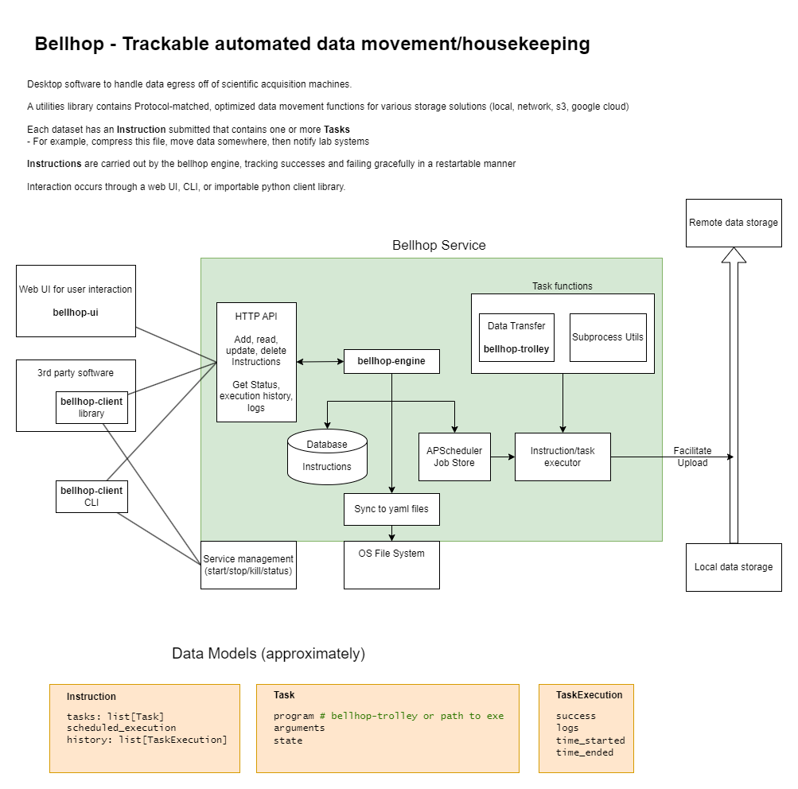

# Bellhop Architecture

## Introduction

Bellhop is a system designed to manage the transfer of scientific data from experimental computing environments once acquisition is complete. 

### Prototypical Use Case

Scientific data is collected and saved to the local storage of a lab/acquisition computer, and the data needs to be transferred off the computer into some centralized storage solution. Many sessions are collected, and each dataset needs to be handled identically. A potential simple procedure for data egress is:

1. Copy the data files from a local drive to a shared network location
2. Notify the lab's database that the experiment is complete and the data is now available
3. Delete the copy of the dataset from the local drive

In practice, procedures like this can get more involved, such as needing to send subsets of the data to multiple places, or running a small analysis, compression, or metadata-extraction step before copying the data.

Additionally, any step may fail for various reasons, and this needs to be noticed and fixed.

In a lab, there may be many such data egress procedures for various instruments, and they may need to be slightly different.

### High-level design

Bellhop contains 4 main components:
- **bellhop-trolley**: Utilities for moving data to various storage backends
- **bellhop-engine**: A system for executing and tracking data transfer procedures for many datasets
- **bellhop-ui**: A frontend user interface for interacting with the bellhop-engine
- **bellhop-client**: A CLI and client library for interacting with the bellhop-engine programmatically



## Bellhop-Trolley

Utilities for data movement, providing large-data-optimized upload/download methods for various storage backends (s3, google cloud) with a consistent interface. Users should be able to use the same `copy` method to move data locally, to a network drive, or to cloud storage.

### Motivation

The [FSSpec](https://filesystem-spec.readthedocs.io/en/latest/) family of projects has done some excellent work providing unified interfaces to storage backends. The [universal-pathlib](https://github.com/fsspec/universal_pathlib) library provides a `UPath` object that acts just like `pathlib.Path`, but works with S3, Google Cloud, Github, etc., automatically parsing the protocol from the path: `s3://bucket/folder/file.txt` becomes an `S3Path`.

For each storage implementation, fsspec has APIs for actually interacting with the filesystem, ([s3fs](https://github.com/fsspec/s3fs), [gcsfs](https://github.com/fsspec/gcsfs)). These power I/O methods (e.g. `cp`, `rm`, `ls`), and allow `UPath` objects to actually access their data. 

So with fsspec libraries, one can do the following:
```python
file = UPath('s3://bucket/folder/file.txt')
file.write_text('hello')
```

So why not just use fsspec libraries for data movement?

In the future, ideally that would be possible, but in its current state fsspec hasn't been performance-optimized to the same level as other, more specific tools. It works great for small files (and is improving for large files), but moving large amounts of data is still best left to other libraries.

### Design

**Bellhop-Trolley is a configurable shim layer between a unified Upath-powered interface and storage-backend-specific data movement libraries**

For example, uploading a file to s3 is usually done via Amazon's `boto3` library. `trolley`'s generic `move_file(source: UPath, destination: UPath)` function accepts UPath arguments, and picks the proper uploader function based on the source/destination UPath types.

```python
# User code
source = UPath('C:/myfile') # resolves to LocalPath
destination = UPath('s3://bucket/myfile') # Resolves to S3Path
trolley.move_file(source, destination)
```

Under the hood, the trolley.move_file does the following:

```python
# Bellhop-Trolley code

class S3Interface(BellhopTrolleyProtocol):
    def move_file(source: LocalPath, destination: S3Path):
        boto3.upload(source, destination)

def _get_interface(type1, type2) -> BellhopTrolleyProtocol:
    # Choose proper interface based on path types
    if type1 == LocalPath and type2 == S3Path:
        return S3Interface
    ...

def move_file(source: UPath, destination: UPath):
    interface = _get_interface(type(source), type(destination))

    interface.move_file()
```

#### Configurability

An upload library like `boto3` might have some configuration options. Those can be set from a bellhop-trolley config file, and optionally overridden for any specific invocation.

Additionally, there may be a few library options for a given storage implementation. For instance, local copies can either use the builtin Python `shutil` library, or call a command-line tool like `robocopy`. Bellhop-trolley contains shims for many of these options, and loads configuration to dictate which one gets used by default.

Users should just have to worry about calling `move_file` on the right filetypes and the bellhop settings can be tweaked separately (not from user code).


## Bellhop-Engine

The bellhop engine is a service to execute and track the success of data handoff tasks for many datasets. It has a small database with the following object types:

- **Task**: A single step, e.g. "Move folder {x} to destination {y}" or "Run {something.exe} on my data"
- **Instruction**: A lists of tasks to perform on a single dataset.
- **TaskExecution**: Historical records of task performance, including success, logs, and datetimes

An example of a prototypical user story is below:

1. After running an experiment trial that generates a dataset, a user submits an **Instruction** to bellhop containing the list of **Tasks** to perform in order to hand off the data from the lab computer into the centralized data infrastructure.

2. The Bellhop engine executes the tasks (at a scheduled time if desired).
    - If a task fails, the **Instruction** execution will stop and register its failed state.
    - Depending on the Instruction's setup, it may retry the failed tasks (skipping the successful ones).

Interaction with the engine is through a HTTP API that supports operations like:
- Submit an instruction
- Modify an instruction
- Get all instructions (with filtering for e.g. `success` or `name-contains`)
- Get history of instruction/task execution, including captured logs from each task.

The bellhop-engine runs in the background as a service.

### Templates

The bellhop engine can store Instruction templates, which make it easier to create a concrete Instruction for a specific dataset based on a general pattern. Templates will be stored as yaml files parametrized using jinja variables like the following example:

```yaml
name: Upload {{ barcode }} Dataset
Tasks:
  - program: Move Data
    kwargs:
      source: D://acquisition_data/{{ barcode }}/
      destination: s3://{{ s3_bucket }}/{{ barcode }}
  - program: Run Subprocess
    args: 
      - C://Program Files/Alleninstitute/notify_database/notify_database.exe
      - {{ barcode }}
```

A new concrete instruction can be created based on the template with a simplified command like this:

`bellhop submit-instruction --from-template "TemplateName" --barcode 123456 --s3_bucket "MyBucketName"`

### Notifications

To aid in monitoring the success or failure of automated instruction execution, a robust configurable notification system is included. This will include a small library of notification options supporting common tools such as email, MS Teams, and Slack. Configuration will allow users to specify their preferred notification method, and what events trigger notifications, such as task/instruction failures.

## Bellhop-UI

The Bellhop UI offers a web interface for interacting with the engine via its REST API.

The UI visualizes completed, in-progress, and scheduled Instructions and Tasks, and provides a clickable interface to dig into status or errors. 

Additionally, the UI provides the ability to manually submit an instruction, or edit and retry a failed one.

## Bellhop-Client

The Bellhop-client is a programmatic interface to the engine's REST API, allowing operations like submitting/updating instructions, or investigating status.

The client can be imported as a python library for use within code, or run directly from the command line.

Additionally, the client has access to the service management component, so it can start/restart/end/monitor the bellhop-engine process. In case of an unexpected crash, a client submitting an instruction can first restart the engine to ensure it's running.